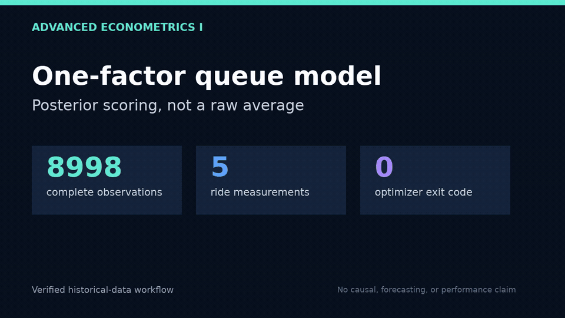

# advanced_econometrics_I



The demo is generated from the committed historical queue dataset. It shows a
statistical reproduction—not live queue data, a forecast, a causal result, or a
performance benchmark. [MP4](docs/demo/factor-score-demo.mp4) ·
[source receipt](docs/demo/capture.json)

## Execute checked coursework code

```bash
Rscript -e 'install.packages(c("knitr","dplyr","mvtnorm"), repos="https://cloud.r-project.org")'
Rscript run_assignment.R Assignment3.rmd
Rscript run_assignment.R Assignment5.Rmd
Rscript run_assignment.R Assignment9.Rmd
Rscript run_assignment.R Exam1_DataAnalysis.Rmd
Rscript run_assignment.R Assignment16.Rmd
```

The runner executes original fenced R code and saves plots/execution text without requiring Pandoc or HTML document rendering. It stops on errors and uses committed datasets. Five assignments (44 code chunks) were verified end to end; other assignments require their specific packages or the original external Greene CSV. Execution is not a peer review of causal assumptions or interpretation.

## Verified factor-score correction

`Assignment16.Rmd` is preserved as the original coursework. Its final section
uses an unweighted average of per-ride standardized waits as a factor-score
shortcut. `verified_factor_scores.R` adds a checked correction layer using the
fitted one-factor model's conditional expectation, including its estimated
ride-specific variances:

```bash
Rscript verified_factor_scores.R
DEMO_SOURCE_SHA="$(git rev-parse HEAD)" python3 scripts/render_factor_demo.py
python3 scripts/verify_demo.py
```

The regression receipt covers 8,998 complete historical observations, verifies
the vectorized scores against a one-observation calculation, rejects non-finite
scores, pins the observed top timestamp, and demonstrates that the old shortcut
produces a materially different score. It does not validate the model as a
forecast or causal explanation.
